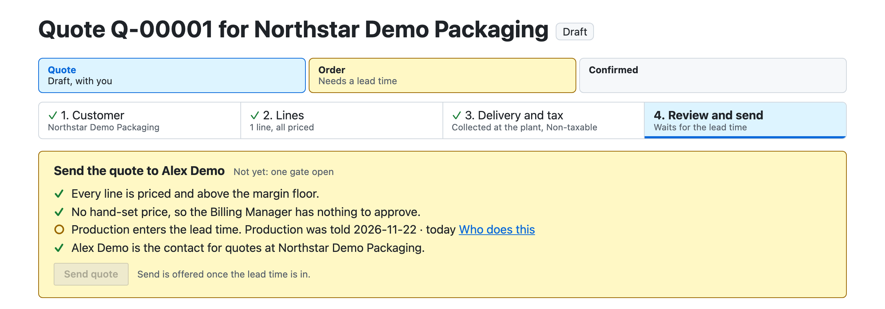
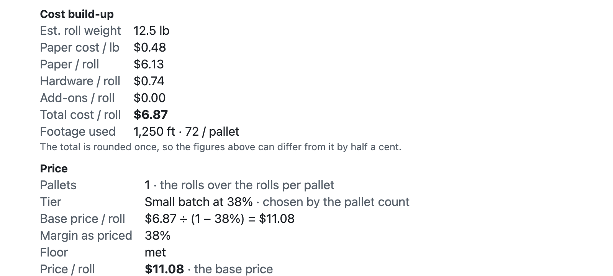
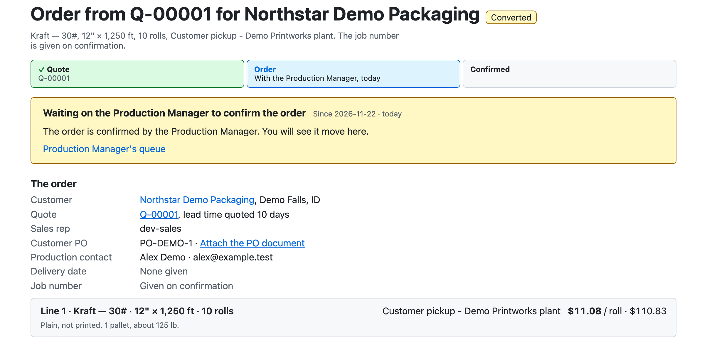

# Print Operations ERP

A production ERP for a custom-printing business, built by directing AI coding agents. It replaced hand-built quotes, re-keyed orders and spreadsheets with one system in which a customer request becomes a priced quote, a production commitment and an order, and every step shows who has to act next.

I'm Warren Vogel. I delivered this for Revolve Print & Pack, a line of business under TPC Holdings, Inc. It went live for that business line in October 2026, and the team uses it from quoting through receivables. Its general-ledger export loads into the company's existing accounting system automatically. The tool saves 25 staff hours a week via a before-after comparison. My original discovery estimates were between 20-40 hours a week, so we landed within expectations.

I owned the requirements, the business rules, the architecture direction, review and acceptance through use. Coding agents wrote most of the code, under operating instructions and checks that I set. Colleagues contributed application code, infrastructure and deployment.

This repository shows two things. The first is the product: one journey of the production system, quote to order, which runs on your machine with one command and has more than 5,000 tests behind it. The second is the engineering system that made agent-written code safe to ship: the instructions the agents worked under, the checks in CI, the review rules and the measurements. It is a public edition, published with the company's permission. Inside the product the business is the fictional Demo Printworks, and its customers and prices are invented.

## What it does

[](docs/images/review-gate-open.png)

_Review and send, before Production has answered. Every condition names the desk that clears it, and Send is not offered until all of them are met._

The journey has three steps, and each one replaced a handoff that used to happen by spreadsheet, email or memory.

1. **Sales prices the work.** Sales enters the paper, width and quantity. The system prices the line from configured grades, tiers and freight rules, checks it against the margin floor and shows how the price was built. Sales no longer waits on Billing for a price.

   [](docs/images/price-explained.png)

2. **Production commits to a lead time.** A quote cannot go out until Production has entered one, so Production knows the work is coming before the customer does. That is the open condition in the screen above.

3. **The agreed terms carry into the order.** The accepted quote becomes an order that keeps the quoted prices and the customer's PO. Whoever receives the PO can record it, because that commits the company to nothing. The Production Manager's confirmation is the commitment, and it gives the order its job number.

   [](docs/images/order-waiting-on-production.png)

Full screens: [entering a line](docs/images/quote-line-entry.png), [the price build-up](docs/images/price-build-up.png), [review and send with every condition met](docs/images/quote-review-and-send.png), [the order handed to Production](docs/images/order-handoff.png) and [the confirmed order](docs/images/order-confirmed.png). All of them are from the demonstration edition running locally with fictional data.

## Three ways in

The [documentation index](docs/README.md) lists everything else. [Delivering an ERP with coding agents](docs/product-ownership.md) tells the whole story in one page.

| If you want to know | Start with | Time |
| --- | --- | --- |
| How I delivered it with coding agents | [A failure the tests did not catch](#a-failure-the-tests-did-not-catch) and [the system around the agents](#the-system-around-the-agents), both below. Then [Working with coding agents](docs/process/working-with-coding-agents.md) | 10 min |
| What it does and whether it worked | [`pnpm demo`](#run-it) and the [walkthrough](#walk-through-it). The business problem is in [Problem and process](docs/product/problem-and-process.md) and every figure is on the [metrics page](docs/metrics.md) | 10 min |
| How it is implemented | [Architecture](docs/architecture.md), then one module layer by layer in [`modules/orders/`](modules/orders/README.md) and the [contract suites](modules/orders/test/contracts/) that hold both storage adapters to one promise | 10 min |

## A failure the tests did not catch

In late August 2026 the tests were green, the pipeline was green, and some of the work could not be done by the people it was built for.

I found that out while writing training tours for each role. Seven acts had a working API route and passing tests and no screen. Entering a quote's lead time was one of them, and sending a quote was another. I ordered an audit of every role's work. Agents ran it as three read-only registers that asked one question of every story and route: can the person in this role do it in a browser without an engineer? It found 20 more.

Agents built the missing screens, and two things changed for good.

- **A check in the build.** [`every-write-route-has-a-screen`](apps/api/test/every-write-route-has-a-screen.test.ts) parses the API and the web app and fails when a write route has no page that calls it. Its allowlists are empty.
- **The definition of done.** A workflow is done when the person who owns it can complete it in a browser, and a [browser journey](tests/portfolio/quote-to-order.spec.ts) proves it. The rule is in the [definition of done](docs/process/definition-of-done.md).

The check proves that a screen calls the route. It cannot prove that a person can do their job with that screen. That is acceptance, and it stayed with me. [The UI completeness audit](docs/process/ui-completeness-audit.md) has the full account.

## The system around the agents

Agents co-authored 86.6% of the non-merge commits, and I made 97.6% of the merges. I did not read every line. What made that workable is a set of connections between the agents and the rest of the engineering process, and each one is in this repository.

- **Instructions and reusable rules.** [`CLAUDE.md`](CLAUDE.md) sets the rules of the repository: the module boundaries, how a decision gets recorded and what an agent may never do. [`.claude/`](.claude/README.md) holds the permission policy and the workflow skills. When something went wrong, the usual fix was a dated rule in the instructions or a new check, so the lesson outlived the session that learned it. Both are adapted from the files the agents worked under.
- **Agents and CI.** The build fails when a convention is broken, not only when a test fails. The `every-…` tests in [`apps/api/test/`](apps/api/test/) and [`apps/web/src/app/`](apps/web/src/app/) parse the source and catch the mistake nobody writes a test for. Each storage port's promises are written once in [`test/contracts/`](modules/orders/test/contracts/) and run against both the in-memory and the PostgreSQL adapter, a rule that dates from one day in which four defects came from the two disagreeing. When the pipeline itself became the bottleneck, I identified the cause and directed a restructure that took the median run from 88 min 56 s to 10 min 17 s. The intern I directed installed the dedicated runners, and that hardware accounts for most of the gain. [The pipeline restructure](docs/process/pipeline-restructure.md)
- **Agents and documentation.** A code change re-reads the page that describes it in the same change and names that page in a `Docs-Verified` commit trailer, which 433 commits carry. A [documentation check](ci-gates/) catches damage that still renders as valid markdown. Comments in the code cite the requirement or decision they implement by its path, so an agent that lands in a file reaches the reasoning without searching.
- **Agents and the issue tracker.** A triage service starts an agent run when a defect report arrives. It has handled about 30 to 40 tickets by my estimate, classifying each correctly as a defect or a feature request and starting fix sessions for defects. An intern I directed built it to my specification. [Decision record 011](docs/decisions/011-agent-triage-of-defect-reports.md)
- **Agents and code review.** Agents worked in scoped lanes, stopped at four gates for a reply, opened merge requests and never merged. A change to the rules agents work under needs a person behind it. The [merge gate](ci-gates/governance-guard.mjs) reads the commit trailers, and an owner's own branch still gets a warning if an agent co-wrote it. It sees an agent only where a commit declares one.
- **Parallel agents on one machine.** Agents worked in separate worktrees of one repository, and git keeps a single stash list for all of them. After one agent's stash pop took another's uncommitted files, a [hook](.claude/hooks/) now parses every shell command and refuses the ones that change the stash list.
- **Measured.** Every number on this page is on the [metrics page](docs/metrics.md) with its scope, date and source.

The gate and hook tests run on their own with `pnpm test:gates`. How the work ran day to day is in [Working with coding agents](docs/process/working-with-coding-agents.md), and the checks a change met, in order, are in [Verifying agent-written code](docs/process/verifying-agent-written-code.md). The orchestration model is [decision record 008](docs/decisions/008-operating-model-for-coding-agents.md).

## Two business rules, from decision to code

The permissions and state changes in this code come from decisions about how the business works. Here are two, each with the code that enforces it and a test that fails without it. Both are conditions on sending a quote, and both appear in the screen at the top of this page.

**Production enters the lead time.** The first plan was a lead time computed from the schedule and inventory. There was no production schedule to compute from, so the stakeholders had the Production Manager enter it on each quote. I later ruled that it counts calendar days, because the shop prints on weekends and a business-day count would describe a week the shop does not keep.

- The rule: [requirement R5](docs/product/requirements.md#r5-production-supplies-the-lead-time-before-the-quote-can-be-sent) and [decision trace 1](docs/product/decisions.md#1-production-enters-the-lead-time-in-calendar-days)
- The code: `#assertMayMove` in [`quote-service.ts`](modules/quoting/src/services/quote-service.ts), which every move to Quoted passes through
- A test: "refuses to send a quote with no lead time" in [`quote-service.test.ts`](modules/quoting/test/quote-service.test.ts)

**The margin floor is absolute, and a hand-set price is a separate control.** Two backlog stories said an approval could release a quote priced below the margin floor, and one had shipped that way. The business requirement said the floor was absolute. I ruled for the requirement: no approval releases a below-floor quote, and the remedies are to re-price the line or for the Billing Manager to change the floor. A hand-set price at or above the floor became its own control, approved by the Billing Manager. I later allowed an Admin alone to override the floor on one quote with a recorded reason. The lesson went into [the agents' instructions](CLAUDE.md): a backlog's acceptance wording is a summary, not the source.

- The rule: requirements [R6](docs/product/requirements.md#r6-the-margin-floor-is-absolute-for-every-role-but-admin) and [R7](docs/product/requirements.md#r7-a-hand-set-price-needs-the-billing-managers-approval), and [decision trace 2](docs/product/decisions.md#2-the-margin-floor-is-absolute-and-a-hand-set-price-is-a-separate-control)
- The code: the same function, which checks the floor first and the price approval second
- A test: "does not let approval rescue a below-floor quote" in [`quote-service.test.ts`](modules/quoting/test/quote-service.test.ts)

The screen only shows these conditions. The API checks each one again when the quote is sent. [Decision traces](docs/product/decisions.md) has two more, on credit holds and on who may create an order.

## Run it

You need Node.js 22, as `.nvmrc` and `package.json` declare, and pnpm 10. The exact pnpm version is pinned in `package.json`, and `corepack enable` provides it. Turborepo calls a plain `pnpm`, so it must be on your `PATH`. No database, Docker or network account is needed.

```sh
pnpm install
pnpm demo
```

`pnpm demo` builds both applications, starts them and prints `Print Operations ERP is ready: http://127.0.0.1:4330/login`. Open that address. Ctrl-C stops it and discards everything. To use other ports, set `PORTFOLIO_WEB_PORT` and `PORTFOLIO_API_PORT`.

The checks, each run from the repository root:

| Command | What it proves |
| --- | --- |
| `pnpm test` | The launcher's safety settings, the gate and hook tests, and every app's, module's and package's tests pass without a database. Database suites skip here |
| `pnpm test:db` | The same package tests pass against a throwaway local PostgreSQL, which it starts and removes, so both storage adapters meet the same contracts. It should report nothing skipped |
| `pnpm test:portfolio` | The quote-to-order journey works in a real browser against the built demo: the figures carry from quote to order, and the API refuses the wrong role and a missing session. Install the browser once first with `pnpm exec playwright install chromium` |
| `pnpm typecheck` | Every package compiles under strict TypeScript |
| `pnpm lint` | The code meets the lint rules, the module boundary rule among them |

The hosted workflow, [`.github/workflows/checks.yml`](.github/workflows/checks.yml), runs all of these plus `pnpm format:check`.

## Walk through it

About ten minutes. Start `pnpm demo` and open the address it prints. The sign-in page offers four roles. **Switch demo role**, at the top of every page, brings you back to it.

1. **Sign in as Sales.** Choose **Try Sales**. Your work lists your queues, all empty.
2. **Start a quote.** Choose **New quote**, search for `Northstar` and press **Start quote** on Northstar Demo Packaging. Quote Q-00001 opens on step 2, Lines.
3. **Price a line.** Paper **Kraft — 30# — 1,250 ft — Long roll**, then **Choose widths**, width **12"**, quantity **10**, tax treatment **Non-taxable**, and **Price line 1**. The line shows $11.08 a roll and $110.83 in all. The price per roll is rounded for display, which is why ten of them come to three cents less. The panel below says the lead time is waiting on Production.
4. **See how the price was built.** Open **Price build-up**: the cost per roll, the tier chosen by pallet count, the margin floor check and the price.
5. **Try to send.** Open **4. Review and send**. The checklist shows one gate open, Production's lead time, and Send is not offered yet.
6. **Hand over to Production.** Switch to **Production Manager**. Your work shows Q-00001 under Quotes needing a lead time. Open it. The page says only Sales prices and sends a quote. Enter **10** days and **Save lead time**.
7. **Send the quote.** Switch to **Sales**. Q-00001 is now waiting on you. On **Review and send** every condition has a tick. Press **Send quote to alex@example.test**. The quote is marked Quoted, and the email appears in the terminal running `pnpm demo` instead of being sent.
8. **Convert it.** Press **Convert to order**, enter PO number `PO-DEMO-1` and press **Create 1 order**. The order page says it is waiting on the Production Manager to confirm it, and shows the PO and the quoted price.
9. **Confirm the order.** Switch to **Production Manager**. Your work shows the order under Orders to confirm. Open it. The committed lead time is filled in from the quote. Press **Confirm the order**. The order becomes DPW-00001.
10. **Send the confirmation.** Switch to **Sales**, open DPW-00001 from **Production**, **Orders**, and press **Email the order confirmation to alex@example.test**. The order now reads "Emailed to alex@example.test", its PDF is filed under Documents, and the email is in the terminal.

The application's own demo guide, linked from the banner on every page, gives the same journey in brief.

### One step further

- **The margin floor.** As Sales, start a second quote for Northstar. Price the same line, but open **More options** and enter a **Hand-set price per roll** of `7.00`. The line says it is below the floor, with the minimum price, and Review and send will not offer Send. Switch to **Administrator**: the same page offers **Override the floor**, which needs a reason and records it on the quote. The hand-set price still needs the Billing Manager. Back as Sales, request the approval, then as **Billing Manager** approve it under **Approvals**.
- **A credit hold.** As **Billing Manager**, open the customer Cedar Demo Outfitters and press **Place on hold**. As Sales, search for Cedar on **New quote**: there is no Start quote, only **Request an exception**, which needs a reason. As Billing Manager, approve it under **Approvals**, **Exceptions**. Sales can now start exactly one quote, and the next attempt meets the hold again.
- **A page that is not yours.** As Sales, go to `/admin/users`. The application answers "Not allowed". The API makes the same refusals, and the browser journey checks several of them directly.

## What the demo is and is not

- It listens on `127.0.0.1` only, on ports 4330 and 4331 unless you choose others.
- It keeps every record in the API's memory, writes nothing to disk, and forgets everything when it stops.
- It connects to nothing outside your machine. Email is printed to the terminal and the tax lookup is a stand-in. That isolation comes from the launcher, which starts the applications with a fixed set of settings and refuses to start if an `.env` file is present.
- Four fictional accounts can sign in, one per role, with one shared password the launcher holds. The sign-in page shows buttons, not a password form.
- The demonstration settings refuse to run with `NODE_ENV=production`: the local sign-in provider, in-memory storage, role seeding and the fake tax lookup each stop the API at start.

[Security and access](docs/security-and-access.md) has the detail, the code behind each statement and the limits.

## How the code is annotated

The code carries short comments meant for a person or an agent who lands in a file with no context. A comment states the purpose of a file or block, cites the rule it implements by its path in this repository, such as `docs/product/requirements.md (R5)` or `docs/decisions/006-optimistic-concurrency.md`, and says where to look next. The reasoning is one link away, so nobody has to search for it. Each app, module and package also has a `README.md` with its responsibility, its public surface, the rules it enforces and its tests. The convention is written down in [`CLAUDE.md`](CLAUDE.md), section 7. For a short example, open [`modules/quoting/src/tier-selection.ts`](modules/quoting/src/tier-selection.ts). For a fuller one, [`modules/orders/src/services/order-service.ts`](modules/orders/src/services/order-service.ts).

The original code carried comments too, but they named private detail. They were removed for this edition and rewritten against the public documents in this repository.

## Stack

TypeScript throughout: a Next.js web interface rendered on the server, a NestJS API, domain modules behind explicit ports, PostgreSQL through Drizzle, Zod for contracts, Vitest and Playwright for tests, in a pnpm and Turborepo monorepo. It runs on premises in containers and signs users in against the company directory. How each piece was chosen, and what was rejected, is in [the technology stack record](docs/decisions/009-technology-stack.md) and [the ORM spike](docs/decisions/010-orm-spike.md). The demo in this repository runs on one machine, in memory, with demonstration accounts in place of the directory.

## Notice

Published with permission. No license to reuse is granted. See [NOTICE.md](NOTICE.md).
