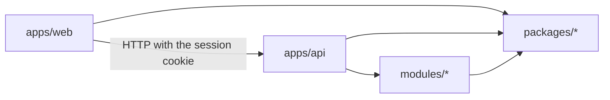

# Architecture

How this repository is laid out and how a request travels through it. The reasons behind each choice are in the [decision records](decisions/). This page links to them instead of repeating them.

## The layout

| Folder | What it holds |
| --- | --- |
| [`apps/web/`](../apps/web/) | The Next.js web app. Pages are server components and every change goes through a server action ([004](decisions/004-server-first-web-ui.md)) |
| [`apps/api/`](../apps/api/) | The NestJS API. It holds no business rules. It wires the modules together, checks the session and the role on every route, and turns module errors into HTTP replies |
| [`modules/`](../modules/) | One folder per bounded context: `identity`, `crm`, `quoting`, `orders`, `documents` and `notifications` ([001](decisions/001-modular-monorepo.md)) |
| [`packages/`](../packages/) | Shared code with no business module behind it: `types` (the contracts every side shares, as Zod schemas), `db` (pools, migrations, ids, test databases), `ui` (React components and tokens), `utils` and `config` (lint, format and test presets) |
| [`infra/db/migrations/`](../infra/db/migrations/) | One folder of SQL migrations per module |
| [`scripts/`](../scripts/) | The demo launcher, the test runners and the embedded PostgreSQL used by tests |
| [`tests/portfolio/`](../tests/portfolio/) | The browser journey and the launcher's tests |
| [`ci-gates/`](../ci-gates/), [`.claude/`](../.claude/), [`CLAUDE.md`](../CLAUDE.md) | The original pipeline's gates and the agents' instructions, with their tests |

Every app, module and package has a `README.md` at its root that states what it owns, its public surface, its rules with their sources, where to start reading and its tests.

The dependency direction is fixed and linted by [`packages/config/eslint/boundaries.mjs`](../packages/config/eslint/boundaries.mjs): an app may import modules and packages, a module may import packages only, and a package may import other packages only. Nothing may import another package's `src/` folder. Each package's `src/index.ts` is its public surface.

## What a module contains

[`modules/orders/`](../modules/orders/) is a small, complete example. Its [README](../modules/orders/README.md) is the place to start.

| Part | In orders | What it is |
| --- | --- | --- |
| Domain rules | [`src/order-state-machine.ts`](../modules/orders/src/order-state-machine.ts), [`src/order-totals.ts`](../modules/orders/src/order-totals.ts), [`src/job-number.ts`](../modules/orders/src/job-number.ts) | Pure functions with no input or output |
| Ports | [`src/ports.ts`](../modules/orders/src/ports.ts) | What the module promises a repository will do, and what it needs from other modules, declared in its own words. `QuoteLookup` asks quoting for lines in the shape orders wants ([002](decisions/002-what-crosses-a-module-boundary.md)) |
| Services | [`src/services/order-service.ts`](../modules/orders/src/services/order-service.ts) | The use cases: convert, confirm, record the PO. They call the ports and never a framework |
| Adapters | [`src/adapters/in-memory/`](../modules/orders/src/adapters/in-memory/) and [`src/adapters/drizzle/`](../modules/orders/src/adapters/drizzle/) | Two implementations of each repository port |
| Schema | [`src/data/schema.ts`](../modules/orders/src/data/schema.ts) | The Drizzle definition of the module's own PostgreSQL schema |
| Public surface | [`src/index.ts`](../modules/orders/src/index.ts) | The only file other code imports |

The other modules have the same parts. Some keep their pure rules in a `domain/` folder, such as [`modules/identity/src/domain/`](../modules/identity/src/domain/), and some keep them at the top of `src/`, such as [`modules/quoting/src/cost-build-up.ts`](../modules/quoting/src/cost-build-up.ts).

## How a request travels

Confirming an order, as the Production Manager does at the end of the journey:

1. The order page [`apps/web/src/app/orders/[id]/page.tsx`](../apps/web/src/app/orders/%5Bid%5D/page.tsx) renders on the server. Its Confirm the order form posts to the server action `confirmOrderAction` in [`apps/web/src/app/orders/[id]/lifecycle-actions.ts`](../apps/web/src/app/orders/%5Bid%5D/lifecycle-actions.ts).
2. The action validates the form and calls the API through `apiFetch` in [`apps/web/src/lib/api-fetch.ts`](../apps/web/src/lib/api-fetch.ts), which forwards the browser's session cookie. The browser never calls the API for a change.
3. In the API, two global guards run first: [`apps/api/src/auth/session.guard.ts`](../apps/api/src/auth/session.guard.ts) finds the session and [`apps/api/src/auth/roles.guard.ts`](../apps/api/src/auth/roles.guard.ts) checks the route's declared roles. A route that declares nothing is refused.
4. The route in [`apps/api/src/orders/orders.controller.ts`](../apps/api/src/orders/orders.controller.ts) parses the body with a schema from [`packages/types/`](../packages/types/) and calls `OrderService`.
5. The service checks the state machine and the caller's `lockVersion` ([006](decisions/006-optimistic-concurrency.md)) and writes through the repository port. The controller maps a stale write or a refused transition to HTTP 409.
6. The action revalidates the page and redirects to it with a notice, so the server renders the new state.

Reads take the same path without the action: a server component calls `apiFetch` and renders the result.

## Where the storage choice is made

Each API factory, such as [`apps/api/src/orders/orders.factory.ts`](../apps/api/src/orders/orders.factory.ts), asks [`apps/api/src/config/persistence-guard.ts`](../apps/api/src/config/persistence-guard.ts) which mode to use and builds either the in-memory or the Drizzle adapters. That function is the only place the choice is made, and it refuses to run a production process in memory ([007](decisions/007-persistence-switch-at-the-composition-root.md)). The factories are also where one module's port is filled from another module's service, so modules never import each other.

Because the demo and most tests run in memory and production runs on PostgreSQL, the two adapters must behave the same. Each port's promises are written once as a contract suite, for example [`modules/orders/test/contracts/order-repository.contract.ts`](../modules/orders/test/contracts/order-repository.contract.ts), and [`modules/orders/test/repository-contracts.test.ts`](../modules/orders/test/repository-contracts.test.ts) runs it against both adapters. The rule came from adapters that disagreed: see [Working with coding agents](process/working-with-coding-agents.md).

## How the database schema is defined and migrated

Each module owns one PostgreSQL schema, defined in its `src/data/schema.ts` ([010](decisions/010-orm-spike.md)). Its migrations are in its own folder under [`infra/db/migrations/`](../infra/db/migrations/). This edition has one baseline per module, `0000_baseline.sql`. Each was generated by drizzle-kit from the schema definition (the module's `drizzle.config.ts` and its `db:generate` script). Five of the six then add CHECK constraints written by hand, because the schema definitions declare none. The end of [`infra/db/migrations/orders/0000_baseline.sql`](../infra/db/migrations/orders/0000_baseline.sql) shows them, with comments naming the rules they hold. The identity baseline has no hand-written part.

[`packages/db/src/migrator.ts`](../packages/db/src/migrator.ts) applies one module's folder and keeps that module's history in its own table in a separate `drizzle` schema. Tests that need a database create a database per module through [`packages/db/src/testing.ts`](../packages/db/src/testing.ts) and apply the module's migrations before they run.

## Where each kind of test lives

| Kind | Where | Run by |
| --- | --- | --- |
| Unit tests of domain rules and services | `modules/*/test/`, `packages/*/test/`, `apps/web/src/**/*.test.ts` | `pnpm test` |
| Contract tests against both adapters | `modules/*/test/contracts/`, run by each module's `*contract*.test.ts` files | `pnpm test` runs the in-memory half and skips the PostgreSQL half. `pnpm test:db` runs both |
| API tests through HTTP, on in-memory stores | `apps/api/test/*.e2e.test.ts` | `pnpm test` |
| Structural checks that parse the source | `apps/api/test/every-*.test.ts` and `apps/web/src/app/every-*.test.ts` | `pnpm test` |
| The launcher's safety properties | [`tests/portfolio/demo-config.test.mjs`](../tests/portfolio/demo-config.test.mjs) | `pnpm test` |
| Gate and hook tests | [`ci-gates/`](../ci-gates/), [`.claude/hooks/`](../.claude/hooks/) | `pnpm test` and `pnpm test:gates` |
| The browser journey | [`tests/portfolio/quote-to-order.spec.ts`](../tests/portfolio/quote-to-order.spec.ts) | `pnpm test:portfolio` |

[Verifying agent-written code](process/verifying-agent-written-code.md) explains what each layer catches and what it misses.
